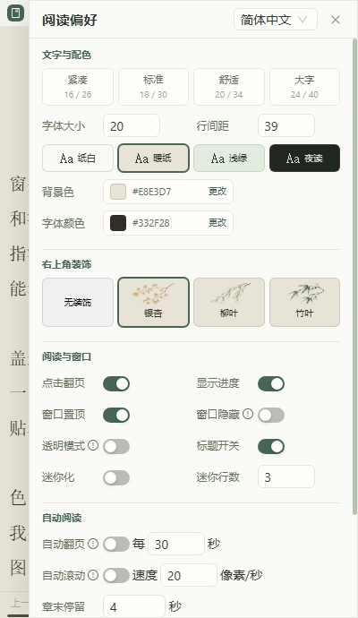
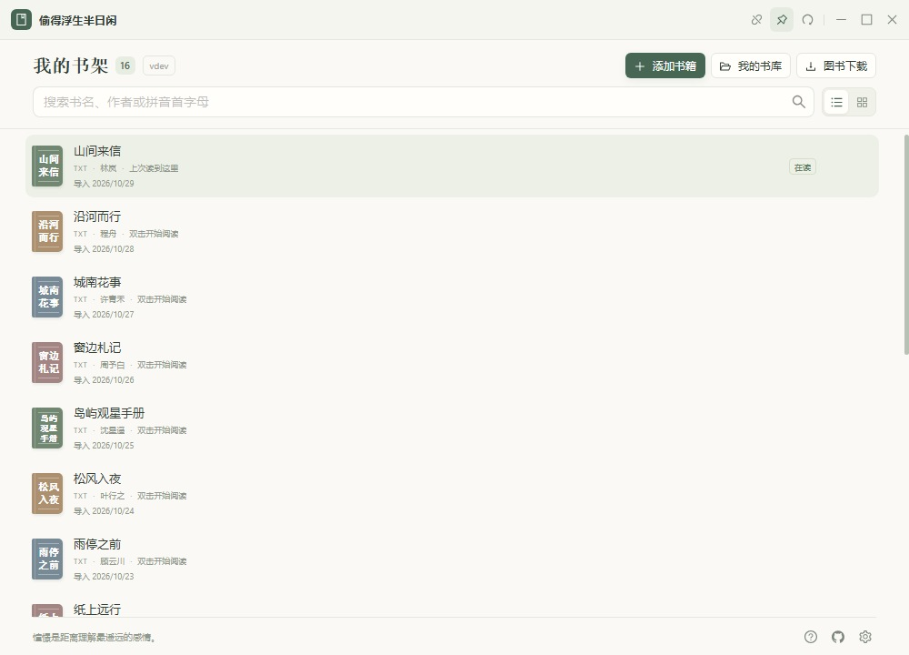
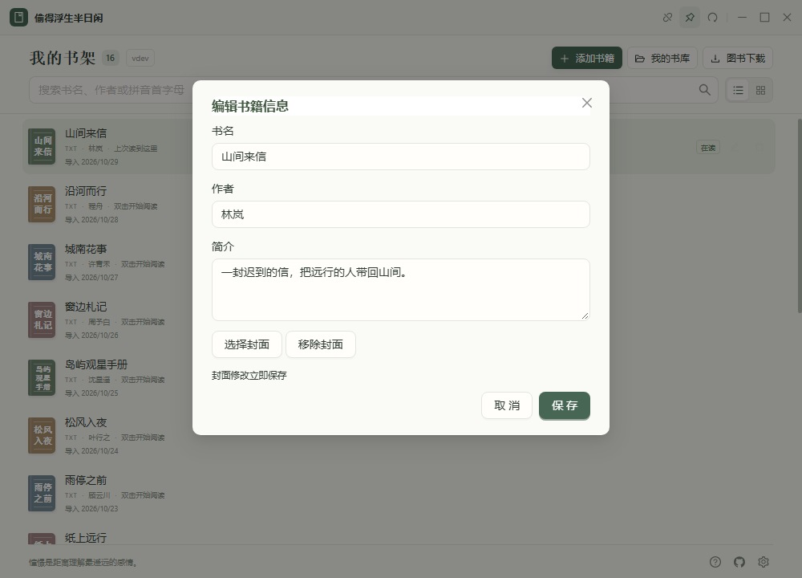
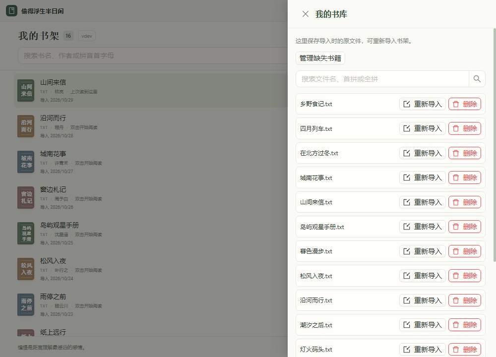
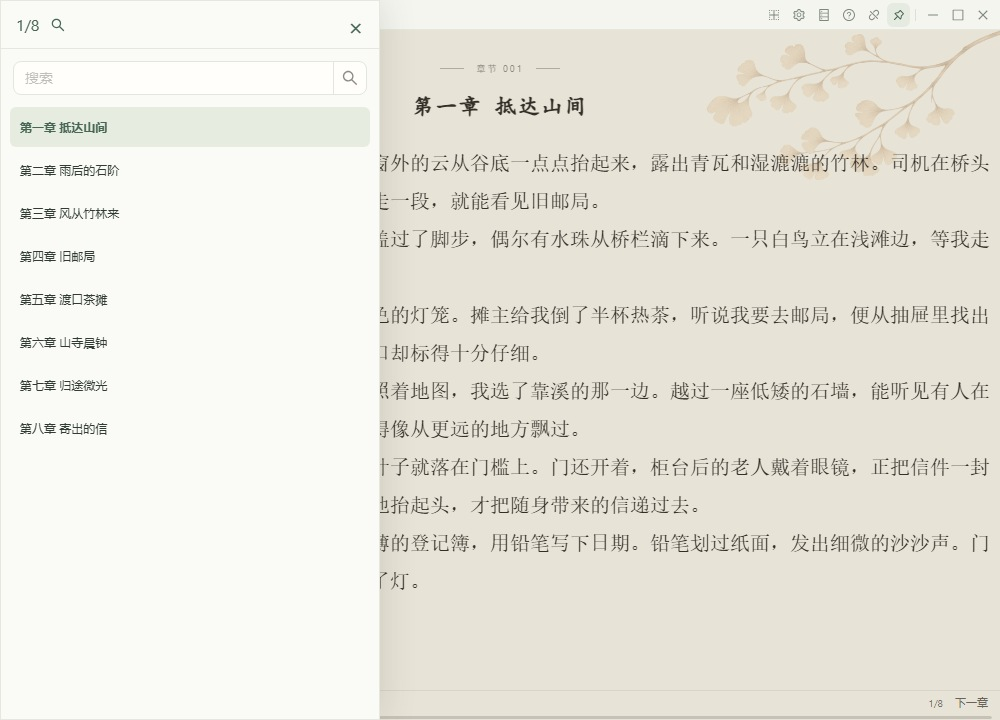
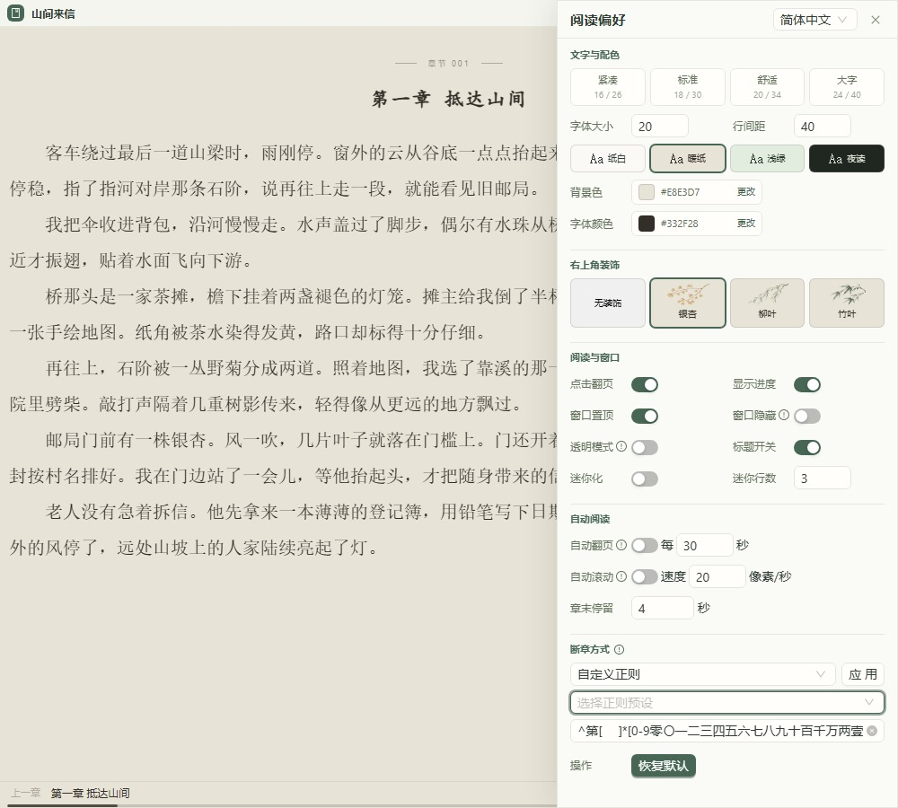
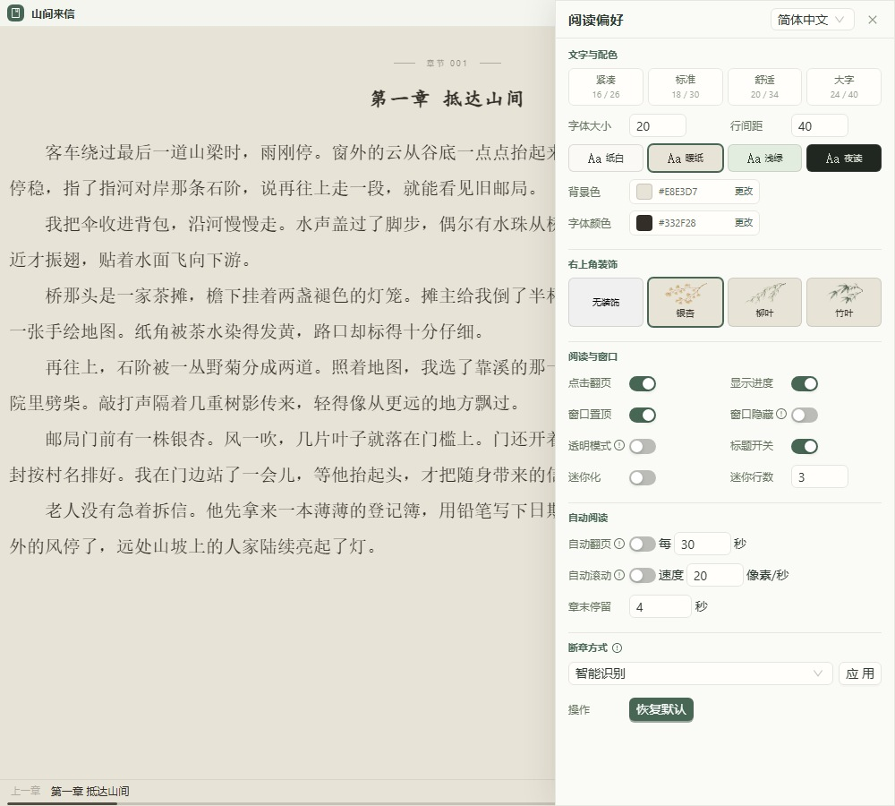

<div align="center">


# wd-reader

[简体中文](README.md) | **English**

**A quiet moment to read.**

A lightweight, distraction-free desktop ebook reader for Windows, macOS and Linux. **Find, download and read ebooks from one bookshelf.** Fetch web novels chapter by chapter, then read the EPUB that the app adds to your bookshelf.

[](https://github.com/lbk-ones/wd-reader/releases/latest)
[](https://github.com/lbk-ones/wd-reader/releases)


[Download the app](https://github.com/lbk-ones/wd-reader/releases) · [Download books](#download-books) · [Screenshots](#screenshots) · [Getting started](#getting-started) · [Development and builds](#development-and-builds) · [Report an issue](https://github.com/lbk-ones/wd-reader/issues)

</div>

## Download books

Open **Download books** from the bookshelf and search by title or paste a supported novel’s detail page URL. Both download methods use the same search, task list and import flow.

| Download method | When to use it |
| --- | --- |
| **Complete book downloads** | Find ready-to-download ebooks from sources including Internet Archive, Project Gutenberg and Chinese ebook catalogs. Filter by TXT, EPUB or Kindle format. This group appears first in the results |
| **Web novel downloads** | Search or paste a book link from one of 31 built-in web novel sources. The app fetches the chapters in order and builds an EPUB with a table of contents and available metadata, including the cover |

- **Choose sources.** Browse sources by group and select or deselect them together. The app checks enabled sources automatically when you open the panel. You can also rerun the check.
- **Browse results.** See the first 10 matches and load 10 more at a time. Filter by format or clear the current search.
- **Track downloads.** Check progress, cancel or retry from the task list. Web novel downloads can fetch chapters in parallel and assemble them in table-of-contents order. Completed downloads appear on the bookshelf automatically.
- **Edit source rules.** Open **Resource sources** to choose a group from the dropdown and edit search, book details, table of contents and chapter content rules in separate form sections.

Source reachability varies by network and site. The crawler rules draw on [So Novel](https://github.com/freeok/so-novel). See the [built-in source list](internal/resourcecatalog/defaults.json) and [resource download guide](docs/resource-downloads.md) for configuration details (in Chinese).

## Features

| Feature | What you can do |
| --- | --- |
| Book downloads | Find ready-made ebooks or fetch web novel chapters and add the finished book to the bookshelf automatically |
| Local bookshelf | Add books or drop files into the window, switch between List and Grid, and search by title, author or pinyin. Recently opened books appear first |
| Book details and originals | Extract metadata and covers from EPUB, MOBI and AZW files, edit titles, authors, descriptions and covers, and re-import original files from My library |
| Text layout | Choose Compact, Standard, Comfort or Large presets, or adjust text size and line height individually |
| Reading appearance | Choose Paper, Warm, Green or Night, customize colors, and add a ginkgo, willow or bamboo corner decoration |
| Flexible window | Keep the reader on top, use transparency, hide the title bar, hide content when the pointer leaves, or read in a 1–4 line mini window |
| Quick hiding | Minimize or restore the window with `Ctrl / ⌘ + Space` |
| Chapter navigation | Detect chapters, search contents, move between chapters, or split text by paragraph count or a custom regular expression |
| Auto reading | Turn pages on a timer or scroll continuously; advance at chapter end and pause while using settings and other panels |
| Reading history | Save chapters, reading positions and preferences automatically and continue next time |
| Everyday controls | Click to turn pages, scroll with the wheel, use the context menu and keyboard shortcuts, or open built-in help |
| Chinese and English | Follow the system language on first launch and save your choice of Simplified Chinese or English |

### Interface language

Open **App settings → Language** from the bottom-right corner of the library, or use the language selector beside the **Reading preferences** heading while reading. Select **简体中文** or **English**. Changes apply immediately and persist across restarts.

On first launch, English systems use English; other system languages default to Simplified Chinese. Book titles, chapter names, text and custom window titles keep their original language. Clearing reading history preserves the language preference; clearing all cache restores the first-launch language rules. See the [internationalization notes](docs/i18n.md) for implementation details (in Chinese).

## Download and installation

Visit **[GitHub Releases](https://github.com/lbk-ones/wd-reader/releases)** and select the asset for your operating system and processor. Available packages depend on the release.

| System | Architecture | Package and setup |
| --- | --- | --- |
| Windows | x64 / ARM64 | Download and fully extract the matching `.zip`, then run `wdreader.exe`. Keep the included `books` folder |
| macOS | Intel / Apple Silicon | Open the matching `.dmg` and drag the app into Applications |
| Linux | x64 | Install the `.deb`, or make the `.AppImage` executable and run it |

In filenames, `amd64` means x64 / Intel; `arm64` means Windows ARM or Apple Silicon.

Release builds check GitHub Releases on startup by default. Open **App settings** from the bookshelf to check manually or turn off startup checks. When a release includes a checksummed update for your Windows portable build, macOS app or Linux AppImage, choose **Install and restart**. To update a Linux DEB installation, download and install the new package from the release page.

Windows requires the WebView2 Runtime. Linux uses GTK4 / WebKitGTK 6, and AppImage also needs the corresponding system runtime dependencies. macOS builds target version 12.0 or later; the current packaging tasks use ad-hoc signing without Developer ID notarization.

## Screenshots

The screenshots show the current Simplified Chinese interface with sample books.

### Default window size

The default window is **400 × 690**. The grid fits three columns and adapts to the window width. Reading text wraps to fit, and preferences scroll within their panel.

| List library | Reading | Preferences |
| :---: | :---: | :---: |
|  |  |  |

<details>
<summary><strong>Grid library and contents in a small window</strong></summary>

| Three-column grid | Chapter contents |
| :---: | :---: |
|  |  |

</details>

### Library and reading

Search by title, author or pinyin in either layout. Book cards show the author, import format and import date. The app remembers your last layout.


<details>
<summary><strong>List view, book details and original files</strong></summary>







</details>

The Warm palette is shown with a ginkgo corner decoration. The bottom bar shows the chapter title, number and overall progress. Open contents with `F2` or from the reading context menu.


<details>
<summary><strong>Night palette: dark background and light text</strong></summary>


</details>

### Contents and chapter detection

Search chapter titles, jump to a chapter and see the current position in the contents panel. Smart detection filters empty chapters and merges duplicate content while preserving chapters with the same title but different text.



<details>
<summary><strong>Custom chapter detection for each book</strong></summary>

When automatic detection misses a chapter, split by paragraph count, choose a regular expression preset for common chapter headings, or enter your own expression. Applying the rule prompts you to clear the book’s saved chapter history.



</details>

### Reading preferences

The preferences panel groups the most-used controls.

- **Text and colors** include four text-size and line-height presets, four palettes, and custom colors. Corner decoration is independent of the palette and saves automatically.
- **Reading and window** covers click to turn, progress, always on top, auto hide, transparency, the title bar and mini-mode line count.
- **Auto reading** supports page intervals of 1–3600 seconds or scrolling at 5–100 pixels per second. Enabling either mode disables the other. Set a minimum chapter-end pause of 1–120 seconds for auto scroll.
- **Chapter detection** offers smart detection, paragraph counts or a custom regular expression per book.



<details>
<summary><strong>Built-in help and keyboard shortcuts</strong></summary>

Press `F1` to open help. Browse Getting started, Reading preferences and Shortcuts. The instructions are available offline.


</details>

## Getting started

1. Click **Add books**, drop local files into the library window, or open **Download books** to find ebooks.
2. Double-click a book, or focus it with the keyboard and press `Enter`.
3. Click the text to turn pages or scroll with the mouse wheel. Use the bottom bar to change chapters and press `F2` to open contents.
4. Open **Reading preferences** with the gear button to adjust colors, text, window behavior and auto reading.

### Manage books

After importing a book, you can edit its title, author, description and cover. To edit it later, hover over or focus the book card and choose **Edit book information**.

Open **My library** to search or re-import original files. Deleting a book from the bookshelf removes its reading copy and metadata and leaves the original available for re-import. Deleting the original in My library leaves the existing reading copy available. Open **Manage missing books** to restore or relink missing files, or remove stale entries.

### Supported formats

| Format | Processing | Notes |
| --- | --- | --- |
| TXT | Local | Supports common Chinese encodings and UTF-16 text with a byte-order mark; chapter detection is configurable |
| EPUB | Local | Extracts text for reading, with a focus on text layout |
| MOBI / AZW / AZW3 | Local | Extracts text; encrypted or incompatible files may not open, and large files can take longer |
| DOC / DOCX / PDF / HTML / HTMLZ | Online conversion | Depends on the existing conversion service and its format support. This path uploads files, and the current service uses HTTP |

TXT and EPUB are recommended for everyday reading. This reader focuses on text; conversion of PDF and other formats may not preserve the original page layout.

### Mini mode, transparency and hiding

- **Mini reader:** choose 1–4 lines in preferences and enable Mini mode. Drag the six-dot handle to move the window; press `Esc` or click the expand icon to exit.
- **Mini context menu:** right-click the text to open all actions in a separate always-on-top window. Page and chapter navigation keep mini mode; contents, preferences and other panels restore the normal window. Press `Esc` or focus another window to dismiss the menu.
- **Transparent mode:** use a transparent background and white text over other windows. Choosing a color preset turns transparency off.
- **Auto hide:** hide reading content when the pointer leaves the window and reveal it when the pointer returns.
- **Hidden title bar** leaves a drag area along the top edge of the reading window. Right-click the text and choose **Title bar** to restore the bar.

Auto page turn defaults to 30 seconds and auto scroll defaults to 20 pixels per second. Auto scroll pauses for at least 4 seconds by default before opening the next chapter. Both modes pause in settings, contents or help, while loading books, or when content is hidden. Manual activity restarts the page-turn timer and briefly pauses scrolling.

### Keyboard shortcuts

| Key | Action |
| --- | --- |
| `F1` | Open help |
| `F2` | Toggle contents |
| `F3` or `PageUp` / `F4` or `PageDown` | Previous / next page |
| `↑` / `↓` | Previous / next page. Enabled by default, configurable in Reading preferences |
| `←` / `→` | Previous / next chapter. Enabled by default, configurable in Reading preferences |
| `F5` / `F6` | Previous / next chapter |
| `F7` | Toggle auto page turn |
| `F8` | Toggle mini mode |
| `F9` | Toggle auto scroll |
| `Esc` | Close help; exit mini mode while reading |
| `Enter` | Open the focused book in the library |
| `Ctrl + Space` / `⌘ + Space` | Boss key: minimize / restore the window |

`F2`–`F9`, `PageUp` and `PageDown` mainly apply while reading and pause when editing inputs or using other panels. The boss key requires successful system shortcut registration and may conflict with other apps. Linux support depends on the desktop environment.

### Where are books and preferences stored?

| Data | Location / behavior |
| --- | --- |
| Windows books | `books/` in the working directory at startup; launching from the repository root uses its `books/` folder |
| macOS / Linux books | `~/books/` |
| Book folder structure | `pure/` holds imported originals, `parse/` holds TXT reading copies, and `meta-data/` holds book details, covers and metadata backups |
| Reading positions and preferences | Local WebView localStorage, using the `Wd-` prefix |

**Clear reading history** removes the WebView’s recent book entries, saved chapters and reading positions while preserving typography, colors, language and library layout. **Clear all cache** also removes preferences.

Use **App settings → Import and export resources → Export resources** to save the entire `books/` folder and all browser storage (localStorage and sessionStorage) in a ZIP, including books, covers, categories, favorites, progress and settings. Save the archive outside `books/`.

**Import and merge resources** merges a previously exported ZIP into the current library. Identical files are skipped; different files with the same name are kept as renamed copies, with their covers, categories and reading progress remapped. Current settings and progress take priority, while new cache entries, chapter settings and recent books are merged. Click **Reload** when the import finishes.

## Development and builds

Built with **Go + Wails 3 + React + Ant Design + Vite**. Keep the Wails Go module, CLI and frontend runtime aligned at `v3.1.0`.

The root `main.go` embeds the frontend and icon and starts Wails. Desktop windows and frontend services live in `internal/desktop/`, book parsing and storage in `internal/book/`, and standalone command-line tools in `cmd/`.

### Requirements

- Go **1.26+**.
- Node.js **24 LTS** and npm.
- The `wails3` CLI, with Go’s binary directory on `PATH`.
- Windows: WebView2 Runtime.
- macOS: Xcode Command Line Tools.
- Linux: a C compiler, pkg-config, GTK4, WebKitGTK 6 and other native dependencies. See the [Linux CI workflow](.github/workflows/release-linux.yaml).

### Run locally

```sh
git clone https://github.com/lbk-ones/wd-reader.git
cd wd-reader
go install github.com/wailsapp/wails/v3/cmd/wails3@v3.1.0
wails3 dev
```

The first run installs frontend dependencies and generates Go bindings. Run the following commands from the repository root:

```sh
# Build a production binary for the current system
wails3 build

# Specify the architecture and application version
wails3 build ARCH=arm64 VERSION=2.0.0
```

Output goes to `bin/`: `wdreader.exe` on Windows and `wdreader` on macOS / Linux.

### Package a release

Package on the matching operating system. First update version metadata:

```sh
node scripts/set-version.mjs 2.0.0
```

```sh
# macOS: create .app and .dmg; additional files use name=path
wails3 task darwin:package:dmg ARCH=arm64 VERSION=2.0.0 DMG_FILES="fix-app=build/dmg/fix-app,fix-app_zh=build/dmg/fix-app_zh"

# Linux: create a DEB or AppImage
wails3 task linux:create:deb VERSION=2.0.0
wails3 task linux:create:appimage VERSION=2.0.0
```

See the [Windows workflow](.github/workflows/release-windows.yaml) for portable ZIP assembly and the [macOS workflow](.github/workflows/release-macos.yaml) for the complete DMG process. All three platform workflows can run when a GitHub Release is published or be triggered manually with a version tag.

### Checks and tests

```sh
go test ./...
go vet ./...
npm --prefix frontend ci
npm --prefix frontend test
npm --prefix frontend run build
```

See the [Wails 3 migration notes](docs/wails3-migration.md) for framework migration, platform compatibility and validation, and the [changelog](changelog.md) for changes (in Chinese).

## Feedback and contributions

Report bugs and suggestions through [Issues](https://github.com/lbk-ones/wd-reader/issues). Include your operating system, processor architecture, application version, reproduction steps and relevant logs. For parsing issues, provide a minimal sample without private content if possible.

Before submitting code, run the checks relevant to your change. Include screenshots for interface changes and reproducible samples for reading or parsing changes.

Thanks to [Wails](https://github.com/wailsapp/wails), [React](https://github.com/facebook/react), [Ant Design](https://github.com/ant-design/ant-design) and the other open-source dependencies used by this project.
