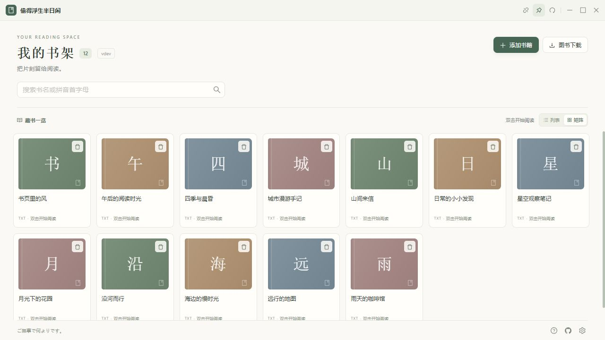
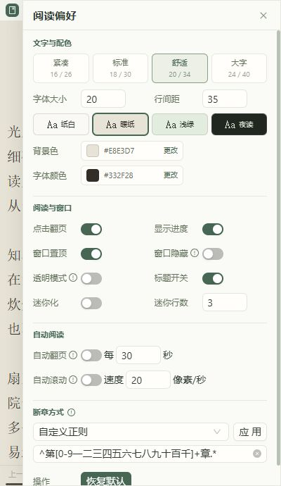

<div align="center">


# wd-reader

**简体中文** | [English](README.en.md)

**偷得浮生半日闲，把片刻留给阅读。**

一款轻巧、低干扰的跨平台桌面电子书阅读器。支持本地书架、迷你阅读、透明窗口与自动阅读，用自己喜欢的方式读完下一章。

[](https://github.com/lbk-ones/wd-reader/releases/latest)
[](https://github.com/lbk-ones/wd-reader/releases)


[下载应用](https://github.com/lbk-ones/wd-reader/releases) · [界面预览](#界面预览) · [开始阅读](#开始阅读) · [开发与构建](#开发与构建) · [反馈问题](https://github.com/lbk-ones/wd-reader/issues)

</div>



## 功能亮点

| 功能 | 你可以做什么 |
| --- | --- |
| 本地书架 | 添加或拖入书籍，切换列表 / 矩阵布局，按书名或拼音首字母查找，快速回到最近阅读的书 |
| 舒适排版 | 在紧凑、标准、舒适、大字四档预设间切换，也可单独调整字号与行高 |
| 阅读配色 | 一键使用纸白、暖纸、浅绿、夜读，或自定义背景色和字体颜色 |
| 灵活窗口 | 窗口置顶、透明背景、隐藏标题栏、鼠标移出隐藏内容，以及 1–4 行迷你阅读 |
| 快速隐藏 | 使用 `Ctrl / ⌘ + Space` 最小化窗口，再按恢复 |
| 章节导航 | 自动识别目录、搜索章节、切换上下章；支持按段落分章和自定义正则 |
| 自动阅读 | 定时翻页或持续向下滚动，章末继续下一章，打开设置等面板时自动暂停 |
| 阅读记录 | 自动保存当前章节、阅读位置和偏好，下次打开继续阅读 |
| 顺手操作 | 点击翻页、滚轮阅读、右键菜单、常用快捷键，以及随时可用的内置使用说明 |
| 中英文界面 | 首次启动跟随系统语言，可在应用设置或阅读偏好中切换简体中文 / English，选择自动保存 |

### 界面语言 / Interface language

在书架右下角打开 **应用设置 → 语言**，或使用 **阅读偏好标题旁的语言选择框**，即可切换简体中文和 English，无需重启。首次启动时，英文系统使用英文，其余系统默认使用中文。语言选择保存在本机；清除阅读记录会保留语言，清空所有缓存则恢复首次启动规则。

Open **App settings → Language** from the library, or use the language selector beside the **Reading preferences** heading while reading. Choose **简体中文** or **English**; changes apply immediately and persist across restarts. Book titles, chapter names, text and custom window titles keep their original language. See [internationalization notes](docs/i18n.md) for development details.

## 下载与安装

前往 **[GitHub Releases](https://github.com/lbk-ones/wd-reader/releases)**，按系统和处理器选择对应附件。各版本实际提供的文件以发布页为准。

| 系统 | 架构 | 发布包与使用方式 |
| --- | --- | --- |
| Windows | x64 / ARM64 | 下载对应的 `.zip`，完整解压后运行 `wdreader.exe`；保留随包提供的 `books` 目录 |
| macOS | Intel / Apple Silicon | 下载对应的 `.dmg`，打开后将应用拖入 Applications |
| Linux | x64 | 选择 `.deb` 安装，或为 `.AppImage` 添加执行权限后运行 |

文件名中的 `amd64` 对应 x64 / Intel，`arm64` 对应 Windows ARM 或 Apple Silicon。

Windows 需要 WebView2 Runtime；Linux 使用 GTK4 / WebKitGTK 6，AppImage 还需要系统具备相应运行依赖。macOS 构建目标为 12.0 及以上，当前打包任务使用 ad-hoc 签名，未配置 Developer ID 公证。

## 界面预览

部分截图展示早期布局；当前版本的首页顶部为紧凑工具栏，默认 400px 窗口的矩阵书架显示三列，窄窗口会自动调整。

### 默认窗口大小

下面是按应用初始尺寸 **400 × 690** 重新截取的小窗口界面。书架会调整为紧凑布局，正文按窄窗口重新换行，设置内容可在面板内滚动查看。点击图片可查看原尺寸。

| 列表书架 | 正文阅读 | 阅读偏好 |
| :---: | :---: | :---: |
|  |  |  |

<details>
<summary><strong>小窗口下的矩阵书架与章节目录</strong></summary>

| 两列矩阵书架 | 章节目录 |
| :---: | :---: |
|  |  |

</details>

### 书架与阅读

列表适合快速查找，矩阵适合浏览。搜索支持书名和拼音首字母，两种布局都会保存选择。

<details>
<summary><strong>列表书架：导入入口、搜索、书籍列表与常用操作</strong></summary>


</details>

暖纸配色搭配居中的章节标题，底栏显示当前章名、章节序号和全书章节进度。点击章名可直接打开目录。


<details>
<summary><strong>夜读配色：深色背景与浅色正文</strong></summary>


</details>

### 目录与章节识别

侧边目录支持按标题搜索、跳转章节，并标出当前阅读位置。智能识别会过滤空章节、合并重复内容，同名但正文不同的章节仍会保留。


<details>
<summary><strong>自定义断章：按书籍选择识别规则</strong></summary>

章节识别不符合预期时，可切换到按段落分章，或输入自己的正则表达式。点击“应用”前会提示清空该书的章节阅读历史。


</details>

### 阅读偏好

从文字、窗口到自动阅读，常用选项集中在同一个面板：

- **文字与配色**：四档字号 / 行高预设、四组配色、自定义颜色。
- **阅读与窗口**：点击翻页、进度显示、置顶、移出隐藏、透明模式、标题栏和迷你行数。
- **自动阅读**：翻页间隔 1–3600 秒；滚动速度 5–100 像素 / 秒，两种模式互斥。
- **断章方式**：智能识别、按段落或自定义正则。


<details>
<summary><strong>内置帮助：随时查看快捷键与操作说明</strong></summary>

按 `F1` 打开使用说明，按主题查看开始阅读、阅读偏好与快捷操作；内置说明可离线使用。


</details>

## 开始阅读

1. 点击书架上的 **添加书籍**，或把本地文件拖入窗口；也可通过 **图书下载** 输入文件链接。
2. 双击书籍开始阅读，或用键盘选中书籍后按 `Enter`。
3. 点击正文翻页、滚动鼠标阅读，使用底栏切换章节，点击当前章名打开目录。
4. 点击齿轮打开 **阅读偏好**，选择配色、字号，以及适合自己的窗口与自动阅读方式。

### 格式支持

| 格式 | 处理方式 | 说明 |
| --- | --- | --- |
| TXT | 本地读取 | 支持常见中文编码及带字节序标记的 UTF-16 文本，可选择章节识别方式 |
| EPUB | 本地解析 | 提取正文用于阅读，以文字排版为主 |
| MOBI / AZW / AZW3 | 本地解析 | 提取文本；加密或不兼容文件可能无法读取，大文件处理时间较长 |
| DOC / DOCX / PDF / HTML / HTMLZ | 在线转换 | 依赖现有转换服务的可用性和格式兼容性；这一路径会上传文件，当前服务使用 HTTP |

日常阅读建议优先使用 TXT 或 EPUB。此项目以文本阅读为主，PDF 等格式经转换后不保证保留原始版式。

### 迷你、透明与隐藏

- **迷你阅读**：在偏好中选择 1–4 行并开启“迷你化”，拖动右侧六点区域移动窗口，按 `Esc` 或点击展开按钮退出。
- **迷你右键菜单**：在正文中右键，使用独立置顶的操作窗口查看全部菜单项；翻页、切章保持迷你模式，打开目录或设置等面板时恢复正常窗口。按 `Esc` 或点击其他窗口收起菜单。
- **透明模式**：使用透明背景并切换为白色文字，适合叠放在其他窗口上；选择配色预设会关闭透明模式。
- **移出隐藏**：开启“窗口隐藏”后，鼠标移出时隐藏阅读内容，移回后恢复。
- **标题栏隐藏后**：右键点击正文，通过“标题开关”恢复，或通过右键菜单重新打开设置。

自动翻页默认间隔 30 秒，自动滚动默认速度 20 像素 / 秒。打开设置、目录或帮助，加载书籍或隐藏内容时会暂停；手动操作后，自动翻页重新计时，自动滚动暂缓后继续。

### 快捷键

| 按键 | 操作 |
| --- | --- |
| `F1` | 打开使用说明 |
| `F2` | 打开 / 关闭目录 |
| `F3` / `F4` | 上一页 / 下一页 |
| `F5` / `F6` | 上一章 / 下一章 |
| `F7` | 开启 / 关闭自动翻页 |
| `F8` | 进入 / 退出迷你模式 |
| `F9` | 开启 / 关闭自动滚动 |
| `Esc` | 关闭使用说明；在迷你阅读正文中退出迷你模式 |
| `Enter` | 打开书架中选中的书 |
| `Ctrl + Space` / `⌘ + Space` | 老板键：最小化 / 恢复窗口 |

`F2`–`F9` 主要在阅读正文时生效，编辑输入框或打开其他面板时暂停。老板键需要成功注册系统快捷键，可能与其他应用冲突；Linux 的支持取决于桌面环境。

### 书籍与记录存在哪里？

| 数据 | 位置 / 行为 |
| --- | --- |
| Windows 书籍 | 启动时工作目录下的 `books/`；开发时从仓库根目录启动即使用根目录的 `books/` |
| macOS / Linux 书籍 | `~/books/` |
| 阅读位置与偏好 | 保存在本机 WebView 的 localStorage 中，使用 `Wd-` 前缀 |

“清除阅读记录”会移除最近阅读、章节记录与阅读位置，保留排版、配色和书架布局；“清空所有缓存”还会清除偏好。迁移到另一台设备时，书籍目录与 WebView 中的记录需要分别考虑。

## 开发与构建

项目使用 **Go + Wails 3 + React + Ant Design + Vite**。Wails Go 模块、CLI 与前端 runtime 固定在 `v3.0.0-beta.33`，开发时请保持一致。

### 环境要求

- Go **1.26+**。
- Node.js **24 LTS** 与 npm。
- `wails3` CLI，并将 Go 的 bin 目录加入 `PATH`。
- Windows：WebView2 Runtime。
- macOS：Xcode Command Line Tools。
- Linux：C 编译器、pkg-config、GTK4、WebKitGTK 6 等原生依赖，具体可参考 [Linux CI 配置](.github/workflows/release-linux.yaml)。

### 本地运行

```sh
git clone https://github.com/lbk-ones/wd-reader.git
cd wd-reader
go install github.com/wailsapp/wails/v3/cmd/wails3@v3.0.0-beta.33
wails3 dev
```

首次运行会安装前端依赖并生成 Go 绑定。以下命令均在仓库根目录执行。

```sh
# 构建当前系统的生产版本
wails3 build

# 指定架构与应用版本
wails3 build ARCH=arm64 VERSION=2.0.0
```

输出位于 `bin/`：Windows 为 `wdreader.exe`，macOS / Linux 为 `wdreader`。

### 打包发布

在对应系统上执行打包。发布前先同步版本元数据：

```sh
node scripts/set-version.mjs 2.0.0
```

```sh
# macOS：生成 .app 和 .dmg，附加文件使用 name=path 格式
wails3 task darwin:package:dmg ARCH=arm64 VERSION=2.0.0 DMG_FILES="fix-app=build/dmg/fix-app,fix-app_zh=build/dmg/fix-app_zh"

# Linux：生成 DEB 或 AppImage
wails3 task linux:create:deb VERSION=2.0.0
wails3 task linux:create:appimage VERSION=2.0.0
```

Windows 便携 ZIP 的组装方式见 [Windows workflow](.github/workflows/release-windows.yaml)；macOS 的完整 DMG 流程见 [macOS workflow](.github/workflows/release-macos.yaml)。三个平台均支持发布 Release 时自动构建，也可手动触发 workflow 并输入版本标签。

### 检查与测试

```sh
go test ./...
go vet ./...
npm --prefix frontend ci
npm --prefix frontend test
npm --prefix frontend run build
```

框架迁移、平台兼容性与验证记录见 [Wails 3 迁移说明](docs/wails3-migration.md)，功能变更见 [更新日志](changelog.md)。

## 反馈与贡献

欢迎通过 [Issues](https://github.com/lbk-ones/wd-reader/issues) 反馈问题或提出建议。报告问题时，请附上系统与处理器架构、应用版本、复现步骤和相关日志；解析问题可提供不含私人内容的最小示例文件。

提交代码前请运行与改动相关的检查；涉及界面时附上截图，涉及阅读或解析逻辑时补充可复现的样例。

感谢 [Wails](https://github.com/wailsapp/wails)、[React](https://github.com/facebook/react)、[Ant Design](https://github.com/ant-design/ant-design) 以及项目使用的其他开源依赖。
